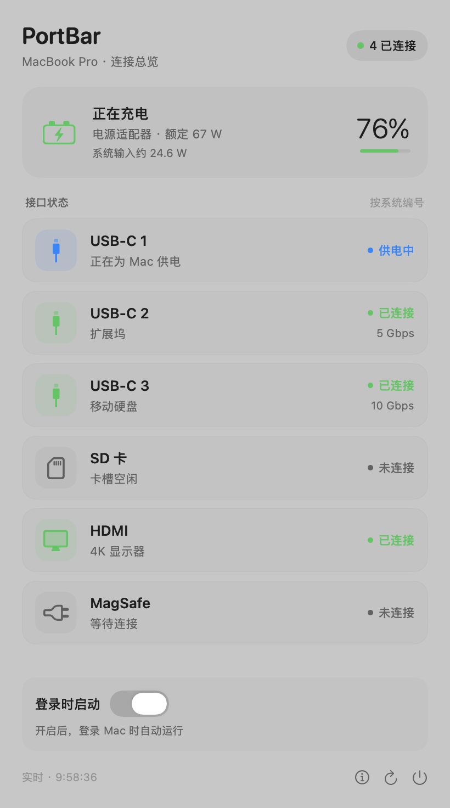
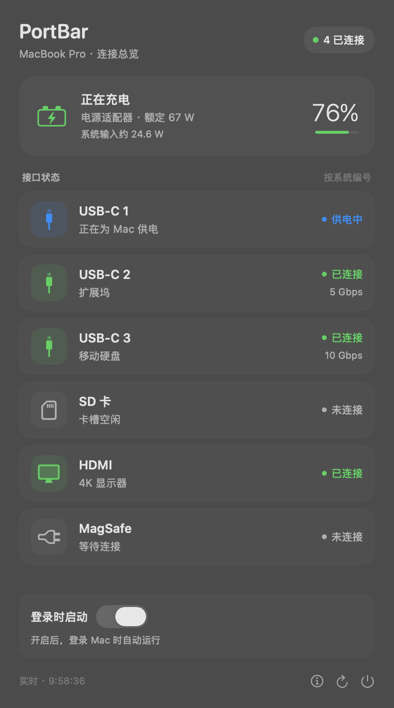

<p align="center">
  
</p>

# PortBar

Mac 菜单栏里的接口与电源状态。一枚紧凑图标，点开查看当前连接、系统报告的链路速率，以及充电信息。

**[下载最新版本](https://github.com/xiangyixuan-k/PortBar/releases/latest)** · macOS 13 Ventura 及以上 · Apple 芯片与 Intel 通用版本

<p align="center">
  
  
</p>

截图使用示例数据，实际接口数量和读数由你的 Mac 提供。

## 开始使用

1. 从 Releases 下载 `PortBar-v0.2.0-universal.zip`，解压后把 `PortBar.app` 拖到“应用程序”。
2. 打开 PortBar，在屏幕顶部菜单栏找到小电脑图标，点击展开。
3. 接入设备后，列表自动更新。需要自动运行时，打开面板中的“登录时启动”。

当前发布包使用临时签名，尚未经过 Apple 公证。如果 macOS 阻止首次打开，请核对下载来源，再按系统提示在“系统设置 → 隐私与安全性”中允许打开。也可以从源码自行构建。

如果自启开关显示需要批准，点击“前往设置”，在 macOS 的登录项设置中允许 PortBar。关闭开关即可取消自启；通过系统设置关闭后，应用也会同步显示状态。

## 可以看到什么

- 根据系统提供的接口清单显示 USB-C、USB-A、SD、HDMI、MagSafe 等接口，不固定套用某款 MacBook 的数量。
- 已连接、未连接、供电中、待授权或不可读的状态，以及系统可提供的设备名、链路速率。
- 笔记本的电量、充电状态、适配器额定功率和系统输入功率；桌面 Mac 使用电源状态界面。
- 深浅色外观、原生弹出面板与平滑状态更新；接口较多时可以滚动查看。
- 约每秒采样一次，同时监听 USB、Thunderbolt、存储和供电事件。面板关闭后仍会刷新，睡眠时暂停、唤醒后恢复。

右键菜单栏图标也可以刷新、切换自启或退出。面板底部的 ⓘ 提供读数说明。

## 机型适配与边界

| 情况 | 显示方式 |
| --- | --- |
| 系统提供逐接口清单与状态 | 显示识别到的实际接口及可用读数 |
| 旧机型或驱动未提供逐接口清单 | 显示识别到的外部 USB 设备、外接显示器及电源信息 |
| 某项数据没有提供 | 显示不可读或留空，不把缺失值当成未连接 |
| 没有内置电池的 Mac | 显示外接电源状态，不显示电池与充电读数 |

兼容目标覆盖运行 macOS 13 及以上的 MacBook、MacBook Air、MacBook Pro、iMac、Mac mini、Mac Studio 和 Mac Pro。**这不代表所有机型都能提供每一个物理接口的状态。** 老款 Mac 的设备视图不能定位到具体插孔，可能无法识别只供电的线缆、空 SD 卡槽或未连接接口。驱动只提供部分接口清单时，列表也可能不完整。

接口编号来自系统，没有校准为机身左侧、右侧或前后位置。链路速率不是实时读写速度；系统输入功率包含电脑运行用电，不能直接当作电池充电功率。连接状态也不能诊断接口是否物理损坏。

### 当前验证范围

- 实机：M1 Pro MacBook Pro，macOS 26.5.1。
- 通用包包含 arm64 和 x86_64；两种架构均通过解析与刷新测试，x86_64 在 Rosetta 下运行验证。
- 模拟数据覆盖两接口 MacBook Air、桌面 Mac、Intel 电池容量换算、新式通用型号标识及旧驱动回退。
- 尚未在实体 Intel Mac、每一款 Mac 或 macOS 13–15 上逐一验证；尚未完成真实插拔和重启自启的全流程测试。

如果你的机型显示不完整，欢迎提交 Issue，注明机型、macOS 版本、连接的设备和期望看到的状态。分享诊断数据前请自行检查并移除个人设备名称。

## 本地数据

接口与电源数据通过 macOS 的 IOKit 和电源 API 本地读取。应用不包含联网、遥测或自动上传代码；普通使用不需要辅助功能、完全磁盘访问或管理员权限。

## 从源码构建

安装 Xcode Command Line Tools 后：

```sh
git clone https://github.com/xiangyixuan-k/PortBar.git
cd PortBar
./build.sh
open dist/PortBar.app
```

构建脚本分别编译 arm64 与 x86_64，再合并为通用应用并进行临时签名。安装自启前，请先将应用移到稳定的“应用程序”位置。

```sh
dist/PortBar.app/Contents/MacOS/PortBar --self-test
dist/PortBar.app/Contents/MacOS/PortBar --realtime-test
```

GitHub Actions 会自动构建通用包并运行上述检查。可选的 `--diagnostics` 输出本机读数，`--render path.png --demo` 生成示例界面截图；加 `--dark` 或 `--desktop` 可预览其他外观。
